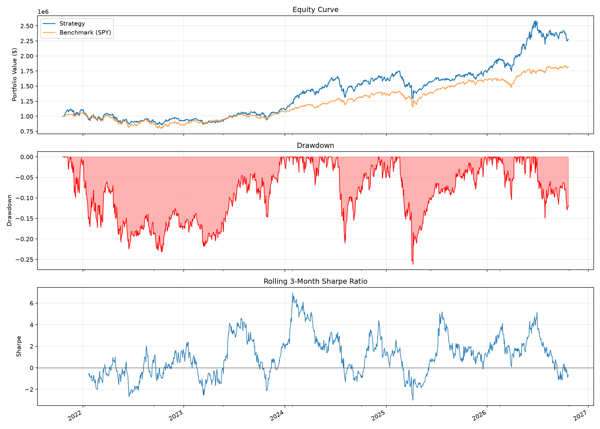

# Quant Trading System / 量化交易系统

A multi-factor quantitative trading system for medium-term US equities. Uses momentum-driven alpha signals, score-proportional allocation with vol scaling, a total turnover cap and sector and position limits, dynamic leverage, and automated execution via Alpaca. A constrained mean-variance optimizer (Ledoit-Wolf covariance, smooth turnover penalty, SLSQP with analytic gradients) is available via `portfolio.allocation: mvo` as a research option; on the backtest windows ending 2026-10-22 it came out below the proportional allocation (multi-factor 5y +127.5% MVO vs +151.8% proportional, both before the backtest was industry-neutralized), so the live books stay on `proportional`.

多因子量化交易系统，专注于美股中期投资。基于动量驱动的 Alpha 信号，按分数比例配置权重，再经波动率缩放、总换手上限、行业与单票上限，结合动态杠杆管理，并通过 Alpaca 自动执行交易。带约束的均值-方差优化器（Ledoit-Wolf 协方差、平滑换手惩罚、解析梯度 SLSQP）可通过 `portfolio.allocation: mvo` 启用，属研究选项：在截至 2026-10-22 的回测窗口上低于分数比例配置（多因子 5 年 MVO +127.5% 对比 +151.8%，两者都是回测尚未行业中性化时的结果），因此实盘账本保持 `proportional`。

**[Paper Performance Dashboard / Paper 模拟盘看板 →](https://yingwang.github.io/trade/)**

The dashboard includes a nightly actual-account alpha attribution for both
paper strategies. Account equity is the truth set; filled orders reconstruct
holdings and strictly lagged ETF regressions split return versus SPY into
market beta, style, industry, stock selection, cash drag, and implementation
shortfall. A separate reconciliation residual exposes deposits, dividends,
missing history, or broker/data discrepancies. Carino linking makes terminal
contributions add exactly to geometric active return.

看板每天对两个模拟账户做真实收益归因：以账户净值为准，以成交重建持仓，再用严格滞后的 ETF 因子回归拆分市场 beta、风格、行业、个股选择、现金拖累与执行成本。无法由六项解释的差额单列为对账残差，不藏入“选股”；期末贡献经 Carino 链接后与几何超额收益严格相加一致。

---

## How we decide / 我们怎么做决策

**Capital stance: paper only.** Line roles: Multi-Factor = **Candidate**; LightGBM = **Research** (paper orders, not a Candidate); Trend = **Sandbox** (params frozen); Earnings Book = **Candidate** (fourth account, from 2026-10-22).

Weekly decisions use paper-window alpha + attribution, execution health, model diagnostics, and written keep/cut/hold — **not** vanity long-window Sharpe. Full contract: [`docs/HOW_WE_DECIDE.md`](docs/HOW_WE_DECIDE.md). Stop gates: [`docs/STOP_CONDITIONS.md`](docs/STOP_CONDITIONS.md). Weekly cards: [`docs/weekly/`](docs/weekly/).

资本姿态：仅 paper。多因子 = **候选线**；LightGBM = **研究线**（干跑遥测）；Trend = **沙盒**（冻参）。周决策看 paper 窗 α+归因、执行健康、模型诊断与书面 keep/cut/hold，**不以**长窗夏普作资本叙事。详见上列文档。


---

## Backtest Performance / 回测表现

> **Configuration**: 5 price-based alpha factors (momentum, 52-week high proximity, short-term reversal, trend persistence, volatility contraction), 12 concentrated positions, 22% target volatility, 3-week rebalance with a 40% cap on total turnover (exit legs and leverage changes included), dynamic leverage with fast regime detection, Almgren-Chriss market impact cost model. Sharpe/Sortino computed against a 4% risk-free rate. Fundamental factors disabled due to yfinance look-ahead limitations.
>
> **配置**: 5个价格因子（动量50% + 52周新高20% + 短期反转10% + 波动率收缩10% + 趋势持续10%），12只集中持仓，22%目标波动率，3周再平衡+40%总换手上限（含退出腿与杠杆变化），快速regime检测动态杠杆，Almgren-Chriss市场冲击成本模型。Sharpe/Sortino 按 4% 无风险利率计算。基本面因子因yfinance前视偏差已禁用。

### Multi-Factor Strategy / 多因子策略 — **Candidate / 候选线**

Recomputed 2026-10-22 by the `README Backtest Refresh` workflow (Actions run [39801405697](https://github.com/yingwang/trade/actions/runs/39801405697)) on commit `e55435f`, windows ending at the last completed session (2026-10-21): one continuous simulation sliced into windows, next-session-open execution, the anchored rebalance calendar, the static sector table on both paths (and, since this run, industry neutralization on the backtest path too), targets computed from the actual drifted book, the volatility-scaled impact model, a turnover cap that may slow a rebalance but not sell the book below min(current, target) gross, and Sharpe/Sortino against a 4% risk-free rate.

由 `README Backtest Refresh` workflow 于 2026-10-22 重算（Actions run 39801405697，commit `e55435f`，窗口止于最近一个已收盘交易日 2026-10-21）：一次连续模拟切成三个窗口，次日开盘成交，锚定的再平衡日历，回测与 paper/模拟盘共用的静态行业表（自这次起回测路径也做行业中性化），目标组合按真实漂移持仓计算，波动率尺度的冲击成本，换手上限只放慢调仓、不把毛头寸卖到「现有」与「目标」两者较低者之下，Sharpe/Sortino 按 4% 无风险利率计算。

#### 5-Year Backtest (2021-10-21 → 2026-10-21)

| Metric / 指标 | Strategy / 策略 | SPY | Difference / 差异 |
|---------------|:-----------:|:---:|:---------:|
| **Total Return / 总收益**  | **+127.5%** | +82.2% | **+45.3pp** |
| **CAGR / 年化收益**         | **+18.0%** | — | — |
| **Sharpe Ratio**        | **0.68** | — | — |
| **Sortino Ratio**       | **0.98** | — | — |
| **Max Drawdown / 最大回撤** | -26.2% | — | — |
| **Information Ratio**   | **0.43** | — | — |

#### 3-Year Backtest (2023-10-21 → 2026-10-21)

| Metric / 指标 | Strategy / 策略 | SPY | Difference / 差异 |
|---------------|:-----------:|:---:|:---------:|
| **Total Return / 总收益**  | **+128.5%** | +90.7% | **+37.9pp** |
| **CAGR / 年化收益**         | **+32.0%** | — | — |
| **Sharpe Ratio**        | **1.15** | — | — |
| **Sortino Ratio**       | **1.71** | — | — |
| **Max Drawdown / 最大回撤** | -26.2% | — | — |
| **Information Ratio**   | **0.56** | — | — |

#### 1-Year Backtest (2025-10-21 → 2026-10-21)

| Metric / 指标 | Strategy / 策略 | SPY | Difference / 差异 |
|---------------|:-----------:|:---:|:---------:|
| **Total Return / 总收益**  | **+34.5%** | +16.4% | **+18.1pp** |
| **CAGR / 年化收益**         | **+34.7%** | — | — |
| **Sharpe Ratio**        | **1.20** | — | — |
| **Sortino Ratio**       | **1.88** | — | — |
| **Max Drawdown / 最大回撤** | -14.9% | — | — |
| **Information Ratio**   | **1.00** | — | — |

#### Performance Chart / 净值曲线 (5-Year)



The July 2026 tables (5-year +193.6%, Sharpe 0.87, max drawdown -28.9%) were produced before the sector table existed on the backtest path, with targets chained from the previous target rather than the traded book, and with an impact model that charged almost nothing; about half of that excess return does not survive those corrections. The drawdown falls because the 50% sector cap and industry neutralization now actually apply.

2026 年 7 月的表格（五年 +193.6%，Sharpe 0.87，最大回撤 -28.9%）产生于回测路径尚无行业表、目标组合从上期目标而非实际持仓链式推导、冲击成本几乎为零的版本；上述修正之后，其中约一半的超额收益不复存在。最大回撤下降，是因为 50% 行业上限和行业中性化此时才真正起作用。

The earlier 2026-10-22 table (run 39707077519: 5-year +151.8%) still came from a backtest that never industry-neutralized: `SignalGenerator.generate` took its sector map from the fundamentals snapshot, which the backtest does not have, while the live book neutralized every day. Both paths now neutralize by the static sector table, so the table above is the signal the account trades; the correction costs about 24 points over five years. On the same windows the 100 names held in equal weights returned about 17% a year against SPY's 12.8%, and the `docs/research/2026-10-22-alpha-audit.md` memo finds the composite's 21-day rank IC close to zero over 2008-2026: most of this book's excess is the universe and its leverage rather than the ranking.

同日早些时候那张表（run 39707077519，五年 +151.8%）出自一个从未做行业中性化的回测：`SignalGenerator.generate` 从基本面快照里取行业，而回测没有快照，实盘却每天都在中性化。现在两条路径都按静态行业表中性化，上面这张表才是账户真正交易的那套信号，修正让五年少了约 24 个百分点。同样的窗口里，这 100 只等权持有年化约 17%，SPY 12.8%；`docs/research/2026-10-22-alpha-audit.md` 测得合成信号 2008 到 2026 年的 21 日秩相关 IC 接近零：这本账的超额主要来自股票池和杠杆，而非排序。

### Trend Strategy / 趋势策略 — **Sandbox / 沙盒** (params frozen; third paper account)

A third book, on its own Alpaca paper account, built to compete with the two above on raw return: concentrated leveraged trend-following (`quant/trend_strategy.py`, `config_trend.yaml`, `paper_trade_trend.py`). Seven names, chosen by blended 12-1 / 6-1 / 3-month momentum among stocks above their 200-day average, sized by inverse volatility, scaled to a 35% volatility target with up to 1.9x gross. Three market warning lights (SPY below its 200-day average, SPY 21-day volatility above 30%, fewer than 30% of the universe above their 50-day averages) cap gross at 0.6x with one light on and send the book to cash with two. Rebalance every ten sessions on the shared anchored calendar; every session checks trailing stops (20% below the highest close since entry) and the regime cap, and acts the same day. The parameters were settled by a twelve-variant sweep on the five-year window: rebalancing every ten sessions rather than five and holding seven names rather than ten were the two changes that mattered, while tighter stops and a softer regime cut both hurt. Backtest tables come from the `Trend Backtest` workflow and `README Backtest Refresh` with the trend option; they carry the same survivorship caveat as the multi-factor table.

第三个账户走的是另一条路：集中、带杠杆的趋势跟随。在 200 日线之上的股票里按 12-1、6-1、3 个月动量混合排序取前七只，按波动率倒数配权，把组合年化波动定在 35% 并允许最高 1.9 倍毛头寸；大盘破 200 日线、大盘 21 日波动率超过 30%、市场宽度弱于 30% 这三盏警示灯亮一盏毛头寸压到 0.6 倍、亮两盏清仓。每十个交易日按共享的锚定日历调仓，每个交易日检查 20% 移动止损与仓位上限并当天执行。参数由五年窗口上的十二组对照定下：十日调仓代替五日、七只代替十只是两处真正起作用的改动，收紧止损和放松减仓门槛都更差。回测表由 `Trend Backtest` workflow 生成，幸存者偏差的说明与多因子表相同。

Recomputed 2026-10-22 by the `README Backtest Refresh` workflow (Actions run [39801405697](https://github.com/yingwang/trade/actions/runs/39801405697)) on commit `e55435f`, windows ending 2026-10-21, with the trailing stop measured from the highest close since entry (the 18 September fix) and the turnover cap that lets an under-invested book re-lever, the same continuous simulation sliced into windows as the multi-factor tables above. Static universe, so the same survivorship caveat applies, and the concentration (seven names, up to 1.9x gross) makes the numbers more sensitive to it than the multi-factor book's.

由 `README Backtest Refresh` workflow 于 2026-10-22 重算（Actions run 39801405697，commit `e55435f`，窗口止于 2026-10-21），移动止损已按入场以来最高收盘计算（9 月 18 日的修正），换手上限也已允许欠配的账户加回仓位，与上面多因子表同样是一次连续模拟切成三个窗口。股票池是静态的，幸存者偏差的说明同上；这一本只持七只、最高 1.9 倍毛头寸，对这种偏差比多因子那本更敏感。

### 5-Year Backtest (2021-10-21 → 2026-10-21)

| Metric / 指标 | Strategy / 策略 | SPY | Difference / 差异 |
|---------------|:-----------:|:---:|:---------:|
| **Total Return / 总收益**  | **+205.0%** | +82.2% | **+122.8pp** |
| **CAGR / 年化收益**         | **+25.1%** | — | — |
| **Sharpe Ratio**        | **0.75** | — | — |
| **Sortino Ratio**       | **1.09** | — | — |
| **Max Drawdown / 最大回撤** | -33.3% | — | — |
| **Information Ratio**   | **0.54** | — | — |

### 3-Year Backtest (2023-10-21 → 2026-10-21)

| Metric / 指标 | Strategy / 策略 | SPY | Difference / 差异 |
|---------------|:-----------:|:---:|:---------:|
| **Total Return / 总收益**  | **+235.4%** | +90.7% | **+144.7pp** |
| **CAGR / 年化收益**         | **+50.1%** | — | — |
| **Sharpe Ratio**        | **1.25** | — | — |
| **Sortino Ratio**       | **1.88** | — | — |
| **Max Drawdown / 最大回撤** | -31.2% | — | — |
| **Information Ratio**   | **0.87** | — | — |

### 1-Year Backtest (2025-10-21 → 2026-10-21)

| Metric / 指标 | Strategy / 策略 | SPY | Difference / 差异 |
|---------------|:-----------:|:---:|:---------:|
| **Total Return / 总收益**  | **+40.0%** | +16.4% | **+23.6pp** |
| **CAGR / 年化收益**         | **+40.2%** | — | — |
| **Sharpe Ratio**        | **1.00** | — | — |
| **Sortino Ratio**       | **1.45** | — | — |
| **Max Drawdown / 最大回撤** | -19.4% | — | — |
| **Information Ratio**   | **0.82** | — | — |

### Earnings Book / 财报账本 — **Candidate / 候选线** (fourth paper account)

A fourth book on its own Alpaca paper account, built in October 2026 after an audit of where the other three books' backtest returns actually come from (`research/`, run on Actions through the `Research` workflow). Measured by 21-day rank IC over 2008 to 2026, the five price factors of the multi-factor book have no ranking power on the hand-picked 100-name universe (composite IC about zero), and that universe's own equal-weighted return, 17.1% a year over the five years to 2026-10-22 against SPY's 12.8%, together with the books' leverage, explains their backtests: SPMO, the S&P 500 momentum ETF, at 1.5x was +190% over the same five years, and the static 100 names equal-weighted at 1.5x were +162%. The SEC's free XBRL fundamentals (`quant/data/edgar.py`, point-in-time by filing date) did not help either: value, profitability, accruals and issuance all measured as weak or unstable.

The one set of signals with a positive IC in every sub-period since 2010 was built from announcements on the point-in-time S&P 500: the consensus earnings surprise, year-on-year EPS growth and 12-6 month momentum (`quant/earnings_strategy.py`, `config_earnings.yaml`, `paper_trade_earnings.py`; the universe is the S&P 500's membership history from the public fja05680/sp500 table and the announcements come from Yahoo's earnings calendar through yfinance). The distance to the next announcement was part of the research composite but is off in the book: its backtest contribution needed the realized date earlier than a company confirms it. The book holds the top 25 names by the composite in equal weights, rebalanced every five sessions, with no stops, no regime lights and no leverage: every one of the trend book's risk devices cost return on this ranking in the variants run on 2026-10-22, and so did inverse-volatility sizing and volatility targeting (`docs/research/2026-10-22-alpha-audit.md`).

第四个账户于 2026 年 10 月建立，起因是一次审计：三本账的回测超额到底从哪里来。用 2008 到 2026 年的 21 日秩相关 IC 衡量，多因子那五个价格因子在那 100 只精选大盘股上没有选股能力（合成 IC 约为零）；超额来自池子本身（这 100 只等权五年年化 17.1%，SPY 12.8%）加杠杆：同期标普动量 ETF（SPMO）1.5 倍杠杆 +190%，这 100 只等权 1.5 倍 +162%。SEC 免费的 XBRL 时点基本面（`quant/data/edgar.py`，按申报日期）也没有带来稳定的因子：价值、盈利质量、应计、增发都很弱或不稳定。

唯一在 2010 年以来每个子时期都为正的信号，来自标普 500 时点池上的财报公告：一致预期的盈利意外、EPS 同比增速，再加 12 到 6 个月的中期动量。研究里的合成还有一项「离下次财报的天数」，账本没有用它：它在回测里的贡献来自比公司确认日期更早地知道日期。账本按合成分数取前 25 只等权，每五个交易日调仓，不设止损、不看灯号、不加杠杆：趋势本的每一样风控装置在这套排序上都减收益，波动率倒数配权与波动率目标也一样（见 `docs/research/2026-10-22-alpha-audit.md`）。

Backtest on 2026-10-22 (Actions run [39757846026](https://github.com/yingwang/trade/actions/runs/39757846026), `research/earnings_book.py`, 2010-01-01 to 2026-10-22, the engine's next-open fills and impact model, no leverage): CAGR 16.7% against SPY's 14.7%, Sharpe 0.63, max drawdown -34.1%; 2016 to 2020 trailed SPY in every year but one (2018 -11.1% against -4.6%). Two cautions: delisted members have no price history, so the universe still favours survivors, and the same configuration moves by about a point of CAGR between runs with Yahoo's coverage of the calendar (an identical variant earlier that day came out at 15.6%). The comparison that counts is the paper record.

The windows below come from the same `README Backtest Refresh` run as the other books' tables ([39801405697](https://github.com/yingwang/trade/actions/runs/39801405697), commit `e55435f`, windows ending 2026-10-21), one continuous simulation started five years back; a book started in 2010 arrives in October 2021 holding other names, which is why the long run's own five-year slice reads higher (+181.2%).

| Window / 窗口 | Strategy / 策略 | SPY | Difference / 差异 | CAGR | Sharpe | Max DD |
|---|:---:|:---:|:---:|:---:|:---:|:---:|
| 5-Year (2021-10-21 → 2026-10-21) | +146.0% | +82.2% | +63.8pp | +19.8% | 0.73 | -21.1% |
| 3-Year (2023-10-21 → 2026-10-21) | +143.4% | +90.7% | +52.8pp | +34.8% | 1.30 | -19.8% |
| 1-Year (2025-10-21 → 2026-10-21) | +28.4% | +16.4% | +12.0pp | +28.6% | 0.96 | -14.6% |

With a fixed 1.3x gross the four-signal version's 2010-2026 CAGR rose from 16.1% to 17.2% with a 47% drawdown, with 1.5x to 18.4% and 53%; the book runs unlevered until its paper record says otherwise. Tables for this book come from `README Backtest Refresh` with the earnings option.

### LightGBM Strategy / LightGBM 策略 — **Research / 研究线** (paper orders)

Same run, same windows. The model's tables move a long way between runs that should be nearly identical: five years came out at +137.6% in the morning's run (39707077519), +125.1% with the neutralization fix on its branch (39736781949), +136.8% in a run that included the half-formed 10/22 bar (39799812590) and +94.3% here, against +61.7% in the 2026-09-22 run (35768997115). A one-session shift in the start of the continuous simulation changes the first holdings, and with a model this close to noise the path never converges back. Read these numbers as an interval, not a point. The nightly training diagnostics are unchanged (best iteration between 1 and 8, baseline skill negative), and the paper account's excess return since April 2026 is, by the dashboard's attribution, mostly sector exposure. Treat this strategy as research until the model itself shows skill. Its paper account trades on schedule; from 2026-09-18 to 09-22 the schedule ran dry-run and the account sat frozen, so that stretch of its paper record is not the model.

同一次运行、同样的窗口。这个模型的表格在本应几乎相同的几次运行之间相差很大：五年期在当天早上那次（39707077519）是 +137.6%，在行业中性修正的分支上（39736781949）是 +125.1%，在误含 10/22 半截 K 线的那次（39799812590）是 +136.8%，这一次是 +94.3%，而 2026-09-22 那次（35768997115）是 +61.7%。连续模拟的起点挪一个交易日，第一批持仓就不同，而这个模型离噪声太近，路径分开之后不会再收拢。这些数字应当当成一个区间来读，而不是一个点。每夜重训的诊断没有变化（best iteration 在 1 到 8 之间，基线技能为负），模拟账户自 2026 年 4 月以来的超额收益按看板归因主要来自行业暴露。在模型本身显出能力之前，这条策略仍应视为研究项目。它的模拟账户照常定时交易；2026-09-18 到 09-22 定时任务只做 dry-run，账户原样冻结，这一段模拟盘记录反映的不是模型。

| Window / 窗口 | Strategy / 策略 | SPY | Difference / 差异 | Sharpe | Max DD |
|---|:---:|:---:|:---:|:---:|:---:|
| 5-Year (2021-10-21 → 2026-10-21) | +94.3% | +82.2% | +12.1pp | 0.57 | -24.5% |
| 3-Year (2023-10-21 → 2026-10-21) | +88.5% | +90.7% | -2.2pp | 0.96 | -24.5% |
| 1-Year (2025-10-21 → 2026-10-21) | +34.2% | +16.4% | +17.8pp | 1.30 | -11.8% |

Even after rerunning, the default static stock universe must be labelled as
survivorship-biased. A bias-reduced run requires both the optional
point-in-time universe file and delisting-return file described in
`quant/data/point_in_time.py`. The static list was also assembled in 2026 and
includes names that only listed in 2018 to 2020 (SNOW, CRWD, DDOG, NET, ZS),
so any backtest window that starts before their listing carries hindsight in
its universe selection as well as in its survivorship.

---

## Strategy Overview / 策略概述

### Current Configuration (Growth Profile)

| Parameter / 参数 | Value / 值 | Description / 说明 |
|---------|-------|-------------|
| **Alpha Signals** | 5 factors | 动量50% + 52周新高20% + 短期反转10% + 波动率收缩10% + 趋势持续10% |
| **Positions** | 12 (target) | 目标组合 12 只；实际账户在过渡期可多于 12 只，大额退出腿分几期卖出 |
| **Position Bounds** | 3% - 12% | 每只股票的权重范围 |
| **Target Volatility** | 22% | 接近满仓投资，最小化现金拖累 |
| **Rebalance** | Every 21 trading days | 3周再平衡，降低换手成本 |
| **Max Turnover** | 40% per rebalance | 总换手上限（含退出腿与杠杆变化）；超限时向上期组合渐进过渡。预算分两份：退出腿最多用 60%（`exit_turnover_share`），其余留给买入腿，退出腿用不完的仍归买入腿，这样卖出不会挤掉买入 |
| **Max Sector** | 50% | 允许科技股集中但有上限 |
| **Max Drawdown** | 25% | 回测与 paper/模拟盘共用 `risk.max_drawdown_limit`：突破后阻断新开仓、允许减仓卖出并写事件告警；另有日亏损熔断与每日止损 |
| **Stop Loss** | 15% | 单只股票止损线，回测与 paper/模拟盘均每日检查 |
| **Leverage** | Up to 1.8x (calm) / 0.8x (stress) | 动态杠杆，基于SPY波动率的市场环境检测 |
| **Cost Model** | Square-root impact | 固定 15bps + 系数 × 个股 20 日波动率 × √(成交股数 / 20 日 ADV)，两者均取前一日已知值；缺失成交量时退回换手率代理 |

### Signal Pipeline / 信号管道

```
Price Data (yfinance, live path behind a hard data-quality gate)
    │
    ├── Momentum (42d/126d/252d, skip 1m) ─── 50%
    ├── 52-Week High Proximity ──────────── 20%
    ├── Short-Term Reversal (5d) ────────── 10%
    ├── Volatility Contraction (10d/63d) ── 10%
    ├── Trend Persistence (21d autocorr) ── 10%
    │   └── All: Industry-neutral z-score → Winsorize ±3
    │
    ├── Trend Filter: price < 200d SMA → score × 0.5
    └── Blowoff Filter: z-score > 4.0 → score × 0.5
        │
        ▼
    Portfolio construction: score-proportional weights (default;
    constrained MVO via portfolio.allocation: mvo is a research option)
        │
        ├── Sector constraints (max 50% per sector)
        ├── Vol-targeting (22% annual, regime-adjusted)
        ├── Dynamic leverage (21d SPY vol regime detection)
        └── Total turnover cap: 40% per rebalance, on final weights,
            including exit legs and leverage changes
            │
            ▼
    Execution (alpaca-py with safety checks; next-session open in backtest)
```

### Disabled Factors / 已禁用因子

Quality (质量) 和 Value (价值) 因子已禁用（权重=0），因为 `yfinance.Ticker.info` 只提供当前快照数据，在回测中会造成严重的前视偏差。详见 `docs/audit/ALPHA_AUDIT.md`。

接入时点基本面数据源（如 Sharadar ~$30/月）后可重新启用。

---

## Quick Start / 快速开始

### Install / 安装

```bash
python3.12 -m pip install --require-hashes -r requirements.lock
```

`requirements.lock` pins the complete dependency graph and hashes. Direct
dependencies are declared in `requirements.in`; regenerate the lock only as an
intentional dependency update.

### Run a Backtest / 运行回测

```bash
# 5年回测（默认配置）
python run.py backtest --start 2021-03-16 --plot

# 自定义日期范围
python run.py backtest --start 2023-01-01 --end 2026-03-16 --plot

# 输出到指定文件
python run.py backtest --start 2021-03-16 --plot --plot-output my_backtest.png
```

### View Current Signals / 查看当前信号

```bash
python run.py signal
```

---

## Automated Trading with Alpaca / 使用 Alpaca 自动交易

### Setup / 设置

```bash
export ALPACA_API_KEY="your-api-key"
export ALPACA_SECRET_KEY="your-secret-key"
```

### Commands / 命令

```bash
python paper_trade.py --dry-run     # 预览交易（不执行）
python paper_trade.py --status      # 查看当前持仓
python paper_trade.py               # 执行再平衡（需达到21个交易日间隔）
python paper_trade.py --force       # 强制立即再平衡（使用新策略参数）
python paper_trade.py --reconcile   # 对账：策略目标 vs 实际持仓
```

### Safety Features / 安全特性

- **Pre-trade checks**: 单笔订单上限 $50k，日内交易总额上限 $500k，日亏损上限 $25k
- **TWAP splitting**: 大单自动拆分为时间加权分批执行
- **Idempotent orders**: 稳定的 `client_order_id` 防止网络重试重复下单
- **Position reconciliation**: 每次再平衡后自动对账
- **Cross-run concurrency**: 每个账户一个 GitHub Actions 并发组，同一账户的运行串行执行；三个账户互不排队（共用一组时 GitHub 会取消排在中间的任务）
- **Partial-fill recovery**: 部分成交或拒单不会把再平衡错误标记为完成
- **Corporate-action fail closed**: 若 Alpaca 模拟账户仍以拆股前单位记录 BKNG，交易会暂停；这是防止数量被放大 25 倍，不影响代码提交或回测
- **Paper mode gate**: 防止意外连接真实资金（live）账户

### Automate with Cron / 使用 Cron 自动化

```bash
# 工作日美东时间下午 3:55 自动执行（每21个交易日实际再平衡）
55 15 * * 1-5 cd /path/to/trade && python paper_trade.py >> logs/trade.log 2>&1
```

---

## Project Structure / 项目结构

```
trade/
├── config.yaml                 # 策略配置（进攻型）
├── config_etf.yaml             # honest-backtest 的 ETF 对照池配置
├── run.py                      # CLI：回测与信号（含 backtest-lgbm / backtest-trend）
├── paper_trade.py              # Alpaca 自动交易入口（多因子账户）
├── paper_trade_lgbm.py         # Alpaca 自动交易入口（LightGBM 账户）
├── paper_trade_trend.py        # Alpaca 自动交易入口（趋势账户）
├── paper_trade_earnings.py     # Alpaca 自动交易入口（财报账户，标普 500 时点池）
├── paper_trade_common.py       # 各交易入口的共享实现
├── config_trend.yaml           # 趋势本配置（冻参）
├── config_earnings.yaml        # 财报本配置
├── generate_site.py            # 看板数据生成（多因子；仅在 Actions 上跑）
├── generate_site_lgbm.py       # 看板数据生成（LightGBM；仅在 Actions 上跑）
├── site_common.py              # 看板脚本共享逻辑（拆股修正、交易历史）
├── refresh_backtest_tables.py  # README 表格重算（经 readme-backtest workflow）
├── research/                   # 研究脚本（因子 IC、财报信号、基准、新账本变体），只在 Actions 的 Research workflow 上跑
├── quant/
│   ├── strategy.py             # 多因子策略调度器
│   ├── trend_strategy.py       # 趋势本
│   ├── earnings_strategy.py    # 财报本（继承趋势本的机器，自己的信号与池子）
│   ├── attribution.py          # 实际账户 alpha 归因 + Carino 对账
│   ├── data/
│   │   ├── market_data.py      # Yahoo Finance 数据获取
│   │   ├── earnings.py         # 标普 500 历史成分表、Yahoo 财报日历、时点面板
│   │   ├── edgar.py            # SEC EDGAR XBRL 时点基本面（研究用，需 EDGAR_USER_AGENT）
│   │   └── quality.py          # 数据质量检查 + paper/模拟盘质量闸门 + 时点数据管理
│   ├── signals/
│   │   ├── factors.py          # Alpha 因子计算
│   │   ├── factor_analysis.py  # IC/ICIR、因子衰减分析工具
│   │   ├── ml_features.py      # 价格派生特征 + 显式缺失标记
│   │   ├── lgbm_model.py       # 分组 LambdaRank + purged split + IC/ICIR
│   │   └── lgbm_strategy.py    # LightGBM 策略调度器
│   ├── portfolio/
│   │   └── optimizer.py        # 分数比例配置（默认）/ MVO 研究选项 + Ledoit-Wolf + 换手上限 + 风控
│   ├── backtest/
│   │   ├── engine.py           # 事件驱动回测引擎（T+1、每日止损、保证金利息）
│   │   └── report.py           # 报告与分析
│   ├── execution/
│   │   ├── broker.py           # 券商接口 + 模拟券商
│   │   ├── alpaca_broker.py    # Alpaca API 集成
│   │   └── safety.py           # 交易安全模块（限额、TWAP、对账）
│   └── utils/
│       └── config.py           # 配置加载器
├── .github/workflows/          # rebalance ×2、update-site、tests、honest-backtest、readme-backtest
├── tests/                      # 单元测试（离线合成数据）
└── docs/audit/                 # 6-Agent 审计报告（12份文档，历史存档）
```

## System Audit / 系统审计

本系统经过 6-Agent 团队的全面审计和优化（详见 `docs/audit/`）：

| Agent / 角色 | Key Deliverable / 主要成果 |
|-------|-------------------|
| Data Engineer / 数据工程师 | 修复 ffill bug，添加数据质量检查，标记前视偏差 |
| Alpha Research / 因子研究员 | 修复3个因子bug，添加因子分析工具 |
| Execution Engineer / 执行工程师 | 添加完整安全模块（限额、TWAP、对账） |
| Portfolio & Risk / 组合风控 | Ledoit-Wolf协方差、换手率惩罚、行业约束执行 |
| Backtest & QA / 回测质控 | 离线回归测试 + 时序/缺失行情/退市事件边界检查 |
| Lead Orchestrator / 总指挥 | 跨模块集成、最终交付报告 |

---

## Configuration / 配置说明

所有参数在 `config.yaml` 中。当前为**进攻型配置**：

```yaml
signals:
  momentum_windows: [42, 126, 252]
  factor_weights:
    momentum: 0.50         # 核心动量信号
    high_proximity: 0.20   # 52周新高距离
    short_term_reversal: 0.10  # 短期反转
    vol_contraction: 0.10  # 波动率收缩
    trend_persistence: 0.10  # 趋势持续（收益自相关；旧名 volume_momentum，实际从未用过成交量）
    quality: 0.00          # 已禁用（前视偏差）
    value: 0.00            # 已禁用（前视偏差）

portfolio:
  max_positions: 12
  allocation: proportional        # 分数比例配置（实盘默认）；mvo 为均值-方差研究选项
  target_volatility: 0.22
  rebalance_frequency_days: 21    # 3周再平衡
  max_turnover_per_rebalance: 0.40  # 40%总换手上限（含退出腿与杠杆变化）

risk:
  max_drawdown_limit: 0.25
  max_sector_weight: 0.50
  stop_loss_pct: 0.15

backtest:
  rebalance_anchor_date: "2000-01-03"  # 各报告窗口共用固定再平衡相位
  market_impact_coeff: 2.5   # Almgren-Chriss 市场冲击系数（按逐股成交量参与率）
  risk_free_rate: 0.04       # Sharpe/Sortino 按超额收益计算
```

可选的时点研究数据接口：

```yaml
data:
  point_in_time_universe_file: data/pit_universe.csv
  delisting_returns_file: data/delisting_returns.csv
```

二者必须同时提供并通过模式校验；仅提供历史成分股却遗漏退市收益仍会高估结果，因此系统会拒绝这种配置。

---

## Known Limitations / 已知局限

1. **Survivorship bias / 幸存者偏差**: 静态100股票池排除历史退市股，回测收益偏高。ETF control workflow 只用于跨资产稳健性检查，不能量化这个偏差；偏差收敛需要时点成分股与退市收益文件
2. **No point-in-time fundamentals / 无时点基本面**: yfinance只提供当前快照，quality/value因子已禁用
3. **Next-open execution / 次日开盘执行**: 回测中信号在 T 日收盘计算，优先按下一可交易日开盘价成交；若开盘缺失才使用该日收盘，开盘和收盘都缺失则等待，不会沿用旧价格假成交
4. **Paper-trading fills / 模拟盘成交**: Alpaca paper 账户的成交不含真实点差与市场冲击，真实交易（live）成本会更高

4. **Paper corporate actions / 模拟账户公司行动**: BKNG 25 拆 1 于 2026-04-02 生效、2026-04-06 起按拆股价交易。若模拟账户仍显示拆股前数量/成本，自动交易会安全停止，需先在 Alpaca 重置或修复该模拟持仓。已手工补入的拆股现金必须记录在 `dashboard.split_cash_compensations`，避免仪表盘再次自动补账

详见 `docs/audit/CONFIDENCE_ASSESSMENT.md` 和 `docs/audit/FINAL_DELIVERY.md`。

---

## Disclaimer / 免责声明

本软件仅用于教育和研究目的。过去的回测业绩不代表未来表现。使用风险自负。请务必先使用模拟交易（Paper Trading）充分测试，再考虑投入真实资金。